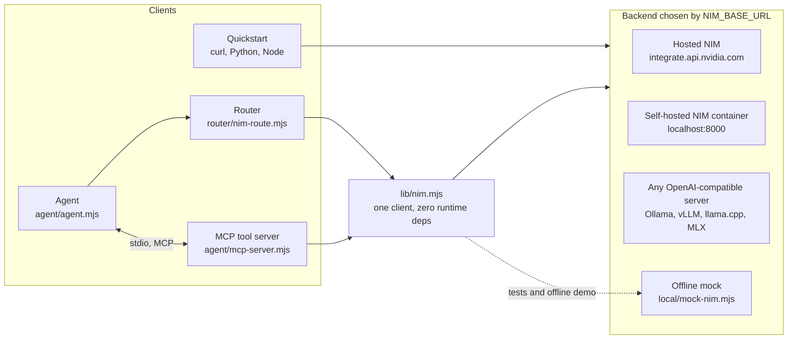
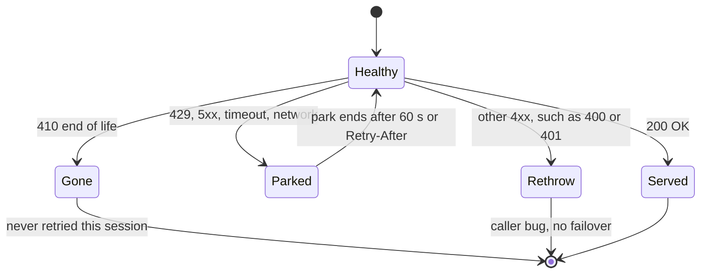
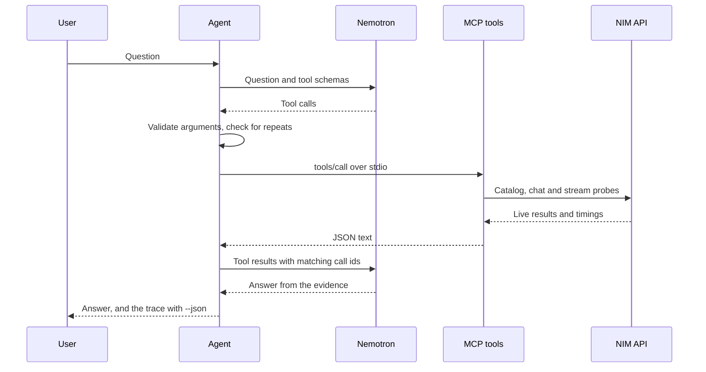

<div align="center">

```text
+------------------------------------------------------+
|  N I M   D E V R E L   K I T                         |
|  Call it. Route it. Measure it. Run it local.        |
+------------------------------------------------------+
```


**A developer kit for NVIDIA NIM. Make a first call in minutes, route around retired and rate limited models, give an agent tools, and move from hosted to local with one environment variable. 🚀**

| | | |
|---|---|---|
| 🚀 [60 second start](#60-second-start-) | 🧭 [Architecture](#architecture-) | 🧩 [The four modules](#the-four-modules-) |
| 🔀 [The router](#the-router-) | 🤖 [The agent](#the-agent-) | 📊 [Measured results](#measured-results-) |
| 🏠 [Hosted to local](#hosted-to-local-in-one-line-) | 🔧 [CLI reference](#cli-reference-) | 📁 [Project layout](#project-layout-) |
| 🧪 [Tests](#tests-) | 🗺 [Roadmap](#roadmap-) | 📜 [License](#license-) |

</div>

---

## Why this exists 💡

You want to call NVIDIA NIM. Then the catalog changes, a model you copied from a tutorial stops working, and a rate limit stops your demo. This kit handles those cases in code you can read.

| Developer problem | What the kit gives you |
|---|---|
| ⏱️ The first call takes too long to get working | Three quickstarts (curl, Python, Node) that find a live chat model, stream the answer and print timings. Measured wall times on 2026-11-21: curl 0.52 s, Python 0.82 s, Node 0.55 s. |
| 🗑️ Catalogs rotate and models retire | The router uses only models in the live catalog. A model that returns HTTP 410 is dropped for the session, and the error carries the end-of-life date. |
| 🚦 Rate limits (429) | A model that returns 429, a 5xx or times out is parked for 60 seconds, or for the `Retry-After` value. The next model answers. |
| 🛠️ Agents need tools | An MCP tool server with four NIM tools, and an agent loop that checks every tool call before it runs. |
| 🔒 Hosted versus local lock-in | `NIM_BASE_URL` moves the same client code between hosted NIM, a self-hosted container, any OpenAI-compatible server and an offline mock. |

## 60 second start ⚡

You need Node 20 or newer and a free key from [build.nvidia.com](https://build.nvidia.com). The key starts with `nvapi-`.

```sh
git clone https://github.com/shoemoney/nim-devrel-kit.git
cd nim-devrel-kit
export NVIDIA_API_KEY=nvapi-your-key-here   # or read it silently, see below
npm install
bash scripts/demo.sh
```

To type the key without it showing on screen or landing in shell history:

```sh
read -rsp 'NVIDIA API key: ' NVIDIA_API_KEY; echo
export NVIDIA_API_KEY
```

No key and no network? Run the whole demo against the bundled offline mock:

```sh
bash scripts/demo.sh --offline
```

The demo has five acts. Hosted, all five run end to end in under 20 seconds of wall time (12 and 16 seconds in two runs on 2026-11-21, capture in `bench/results/2026-11-21-demo-run.txt`). The key is read only from the `NVIDIA_API_KEY` environment variable. Never put it in a file you commit.

## Architecture 🧭

Every module talks to the same OpenAI-compatible API. The router and the agent go through one shared client, `lib/nim.mjs`. The quickstarts call the API directly so each one stands alone.



The backends are interchangeable because the client only uses `GET /v1/models` and `POST /v1/chat/completions`. The offline mock implements the same two routes.

## The four modules 🧩

| Module | What it does | Try it | Read more |
|---|---|---|---|
| ⚡ `quickstart/` | First call in curl, Python or Node | `node quickstart/node/quickstart.mjs` | [quickstart/README.md](quickstart/README.md) |
| 🔀 `router/` | Lists, probes, benchmarks and fails over models | `node router/nim-route.mjs bench` | [router/README.md](router/README.md) |
| 🤖 `agent/` | Nemotron calls four MCP tools to answer a question | `node agent/agent.mjs "Is meta/llama-3.1-8b-instruct still available?"` | [agent/README.md](agent/README.md) |
| 🏠 `local/` | Offline mock and the hosted to local swap | `node local/mock-nim.mjs` | [local/README.md](local/README.md) |

## The router 🔀

The router ranks models, then sends each request to the first model that can answer. Its ranking is the default preferred list, intersected with the live catalog: NVIDIA's small models come first (`nvidia/nemotron-3.5-bolt-e4b`, then `nvidia/nemotron-3.5-lightning-30b-a3b`, then `nvidia/nemotron-3-nano-omni-30b-a3b-reasoning`).

Each error is handled one of four ways:



A real route log from act 3 of the offline demo:

```json
[{"model":"mock/busy","error":429,"parked":true},{"model":"mock/retired","error":410,"gone":true},{"model":"mock/fast","served":true}]
```

Read it left to right: busy was parked, retired is gone, fast served.

The router never fails over on a bad request or a bad key. Switching models does not fix either one, so those errors are raised straight away.

## The agent 🤖

The agent sends a question and the tool schemas to Nemotron. The model picks tools, the agent runs them over MCP, and the model writes an answer from the results. Pass `--json` to see every tool call, its arguments and its result.



The built-in MCP server (`agent/mcp-server.mjs`) registers four tools:

| Tool | Input | What it returns |
|---|---|---|
| `list_models` | `filter` (optional id substring, for example `nemotron`) | Up to 60 live catalog ids, plus the total and matched counts |
| `check_model` | `model` | `alive`, or `end_of_life` with the HTTP 410 detail, `rate_limited`, `not_chat` or `error` |
| `measure_model` | `model`, `runs` (1 to 3, default 2) | Median time to first token and median tokens per second from short streams, plus any errors |
| `supports_tools` | `model` | Whether a forced dummy `ping` call came back as a well formed tool call |

### Tool floor 🧱

The loop enforces these rules in code, so the model cannot break them:

| Condition | What happens |
|---|---|
| Unknown tool name | Returns a tool error the model can correct |
| Invalid JSON or a missing required field | Returns a validation error and does not run the tool |
| Tool throws | Returns the error text as the tool result |
| Result over about 6000 characters | Truncated, with a marker |
| The same call with the same arguments three times in a row | Stops with an explicit repetition message |
| Model turns reach `--max-steps` (default 8) | Stops with an explicit step limit message |

API keys are redacted from tool results before the model sees them.

In the live demo, act 5 asked whether `meta/llama-3.1-8b-instruct` is still available. The agent ran on `nvidia/nemotron-3.5-bolt-e4b`, made four tool calls (`check_model`, `list_models`, `check_model`, `supports_tools`) and quoted the end-of-life date from the 410 result.

## Measured results 📊

Every number in this section comes from the JSON files in [`bench/results/`](bench/results/). The tables are the output of `scripts/render-results.mjs`, with the numbers unchanged.

### Hosted NIM, Nemotron chat models 🏆

Measured 2026-11-21 against the hosted NIM API.

- Runs per model: 5, one model at a time, sequential streams
- Max tokens: 256, temperature 0.2
- Prompt: "In three sentences, explain why KV-cache size limits batch size during LLM inference."
- Node v24.22.3 on Linux

| model | ok | median TTFT ms | TTFT min to max | median tok/s | tok/s min to max | median total ms | median out tokens | errors |
|---|---|---|---|---|---|---|---|---|
| nvidia/nemotron-3.5-bolt-e4b | 5/5 | 179 | 178 to 269 | 88.7 | 88.2 to 89.3 | 915 | 65.0 | - |
| nvidia/nemotron-3.5-lightning-30b-a3b | 5/5 | 121 | 119 to 140 | 185.2 | 105.0 to 196.1 | 1503 | 256.0 | - |
| nvidia/nemotron-3-nano-omni-30b-a3b-reasoning | 5/5 | 138 | 114 to 1107 | 85.0 | 63.0 to 89.8 | 3185 | 256.0 | - |
| nvidia/nemotron-3.5-super-vl-120b-a12b | 5/5 | 376 | 348 to 885 | 129.5 | 62.6 to 160.6 | 2352 | 256.0 | - |
| nvidia/nemotron-3-ultra-550b-a55b | 5/5 | 472 | 455 to 2267 | 37.3 | 20.5 to 37.9 | 3992 | 132.0 | - |

<details>
<summary>📋 Methodology</summary>

- **Client:** one machine on a residential connection in the US.
- **Endpoint:** the hosted NIM API, a shared public endpoint.
- **Sampling:** 5 sequential streamed runs per model, one model at a time, one fixed prompt.
- **Settings:** `max_tokens` 256, temperature 0.2.
- **TTFT:** time to the first content or reasoning delta.
- **Tokens per second:** completion tokens reported by the server, divided by the time after the first token. If the server reports no usage, the count is estimated and marked.
- **Summary:** medians, with the min and max beside each one.
- **Time of day:** one. Raw runs for every sample are in `bench/results/2026-11-21-nemotron-hosted.json`.
- **Reproduce:** `node router/nim-route.mjs bench --models nvidia/nemotron-3.5-bolt-e4b,nvidia/nemotron-3.5-lightning-30b-a3b,nvidia/nemotron-3-nano-omni-30b-a3b-reasoning,nvidia/nemotron-3.5-super-vl-120b-a12b,nvidia/nemotron-3-ultra-550b-a55b --runs 5 --max-tokens 256 --concurrency 1 --out results.json`, then `node scripts/render-results.mjs results.json`.

</details>

**What these numbers are not:**

- Not a ranking for your workload. One prompt, five runs per model, one client.
- Not a benchmark of NVIDIA hardware. The endpoint is shared, so load changes from hour to hour.
- Not a day of data. It is one snapshot from one time of day.
- Not a quality score. The benchmark measures speed only.
- Not comparable with the local run below, which is a different model on different hardware.
- Reasoning models count reasoning deltas toward TTFT.
- Ranges are wide where a single run spiked on the shared endpoint. One `nano-omni` run of five took 1107 ms to first token. The other four took 114 to 213 ms.

### Local portability check, not a comparison 🧪

The same benchmark command ran against a local OpenAI-compatible MLX server on the author's LAN (an M3 Ultra Mac Studio, per the author; the JSON records only the client). Only `NIM_BASE_URL` changed. Measured 2026-11-21.

- Model: `gemma-4-26b-a4b-it-4bit`, a different model and quantization from the hosted set
- Settings: the same 5 runs, 256 max tokens, temperature 0.2 and prompt

| model | ok | median TTFT ms | TTFT min to max | median tok/s | tok/s min to max | median total ms | median out tokens | errors |
|---|---|---|---|---|---|---|---|---|
| gemma-4-26b-a4b-it-4bit | 5/5 | 47 | 47 to 732 | 120.5 | 119.6 to 121.1 | 861 | 88.0 | - |

This run shows that the client code is portable. It does not show that local is faster or slower than hosted. The model, the quantization and the setup all differ, and the server serves one user on a LAN.

## Hosted to local in one line 🏠

The client code stays the same. Point `NIM_BASE_URL` at another OpenAI-compatible `/v1` URL and set `NIM_MODEL` to an id that server lists:

```sh
NIM_BASE_URL=http://localhost:8000/v1 NIM_MODEL=<id from /v1/models> node quickstart/node/quickstart.mjs
```

Local servers need no key. Unset `NVIDIA_API_KEY` if you want to be sure it is not sent. The offline mock works the same way:

```sh
node local/mock-nim.mjs --port 8089 &
NIM_BASE_URL=http://127.0.0.1:8089/v1 NIM_MODEL=mock/fast node agent/agent.mjs "Hello"
```

### What was actually run

| Path | Status |
|---|---|
| Hosted NIM (`integrate.api.nvidia.com`) | ✅ Run on 2026-11-21 |
| Local OpenAI-compatible server on Apple Silicon (MLX) | ✅ Run on 2026-11-21 |
| Offline mock (`local/mock-nim.mjs`) | ✅ Run in the tests and the demo |
| Self-hosted NIM container on an NVIDIA GPU | ⬜ Not run yet. The author has no NVIDIA GPU. The recipe in `local/docker-compose.yml` is written from NVIDIA's documentation. |

<!-- GPU-RUN -->

Going local also means your own model ids, your own capacity limits, and tool calling that depends on the model and the server together.

## CLI reference 🔧

Every flag below comes from the code. Defaults are in parentheses.

| Command | Options | What it does |
|---|---|---|
| `bash quickstart/curl.sh` | env: `NVIDIA_API_KEY`, `NIM_BASE_URL`, `NIM_MODEL`, `NIM_TIMEOUT_SECONDS` (120) | Lists models, picks one, prints a non-streamed reply |
| `uv run quickstart/python/quickstart.py` | same env | Streams a reply and prints time to first token |
| `node quickstart/node/quickstart.mjs` | same env | Streams a reply with built-in `fetch`, no dependencies |
| `bash scripts/smoke-quickstart.sh` | none, needs `uv` | Runs all three quickstarts and prints wall seconds |
| `node router/nim-route.mjs models` | `--base URL`, `--probe`, `--concurrency N` (6) | Lists catalog ids. With `--probe`, classifies each as `chat`, `gone`, `rate-limited`, `not-chat` or `error` |
| `node router/nim-route.mjs bench` | `--base URL`, `--models a,b`, `--all-chat`, `--runs N` (5), `--max-tokens N` (256), `--prompt TEXT`, `--timeout-ms N` (120000), `--concurrency N` (3), `--out FILE` | Times each model with streamed runs and prints a table. `--out` writes JSON with raw runs |
| `node router/nim-route.mjs route` | the bench options, plus `--no-bench`. `--runs` defaults to 2 | Ranks by median TTFT, streams the prompt from the fastest healthy model and prints the route log. `--no-bench` needs `--models` in ranked order |
| `node agent/agent.mjs "question"` | `--model ID`, `--base URL`, `--max-steps N` (8), `--mcp "command"` (repeatable), `--json`, `--quiet` | Runs the tool loop. `--json` prints the answer, steps, tool calls, models used and route log |
| `node agent/mcp-server.mjs` | none | Serves the four NIM tools over stdio. The agent normally starts it for you |
| `node local/mock-nim.mjs` | `--port N` (8089), `--slow-ms N` (400), `--token-delay-ms N` (10) | Offline OpenAI-compatible mock with fault injection |
| `bash scripts/demo.sh` | `--offline`. Env: `DEMO_PAUSE=1`, `MOCK_PORT` (8089) | Runs the five-act demo |
| `node scripts/render-results.mjs FILE...` | one or more bench JSON files | Prints markdown tables from the JSON |
| `npm test` | none | Runs all 86 tests. No network and no key needed |

`--base URL` overrides `NIM_BASE_URL` on every router and agent command. `NVIDIA_API_KEY` is the only place a key comes from.

## Project layout 📁

```text
nim-devrel-kit/
├── quickstart/
│   ├── curl.sh
│   ├── node/quickstart.mjs              # no dependencies
│   ├── node/quickstart-openai-sdk.mjs   # official openai SDK variant
│   └── python/quickstart.py             # uv inline deps, or requirements.txt
├── lib/nim.mjs                          # shared client: config, errors, models, chat, stream
├── router/nim-route.mjs                 # models, bench, route, and the Router class
├── agent/
│   ├── agent.mjs                        # tool loop with a deterministic floor
│   └── mcp-server.mjs                   # four NIM tools over MCP
├── local/
│   ├── mock-nim.mjs                     # offline OpenAI-compatible mock
│   └── docker-compose.yml               # self-hosted NIM recipe (not run by the author)
├── scripts/
│   ├── demo.sh                          # the five-act demo
│   ├── smoke-quickstart.sh              # runs all three quickstarts
│   └── render-results.mjs               # bench JSON to markdown
├── bench/results/                       # raw measured runs, as JSON
├── docs/DEMO.md                         # presenter talk track
├── .env.example                         # the three environment variables
└── package.json
```

## Tests 🧪

```sh
npm test            # all 86 tests, no network, no key
node --test agent/*.test.mjs   # or one module at a time: lib, router, agent, local
```

## Roadmap 🗺

| Status | Item |
|---|---|
| ✅ | Quickstarts in curl, Python and Node, with a smoke script |
| ✅ | Router with probe, benchmark, failover and the 410, 429 and rethrow rules |
| ✅ | MCP agent with four NIM tools and a deterministic tool floor |
| ✅ | Offline mock with fault injection, five-act demo and 86 tests |
| ✅ | Hosted Nemotron benchmark, 2026-11-21, with raw runs |
| 🔨 | Self-hosted NIM container run on an NVIDIA GPU, to replace the documented-only recipe |
| ⬜ | Tool calling latency in the hosted benchmark, not only a pass or fail check |
| ⬜ | Workshop built from the demo, with a timed exercise per act |

## License 📜

MIT. See [LICENSE](LICENSE).

<div align="center">

Built by Jeremy Schoemaker on Apple Silicon. Run `bash scripts/demo.sh --offline` to see the whole thing work with no network. 🍎

</div>
