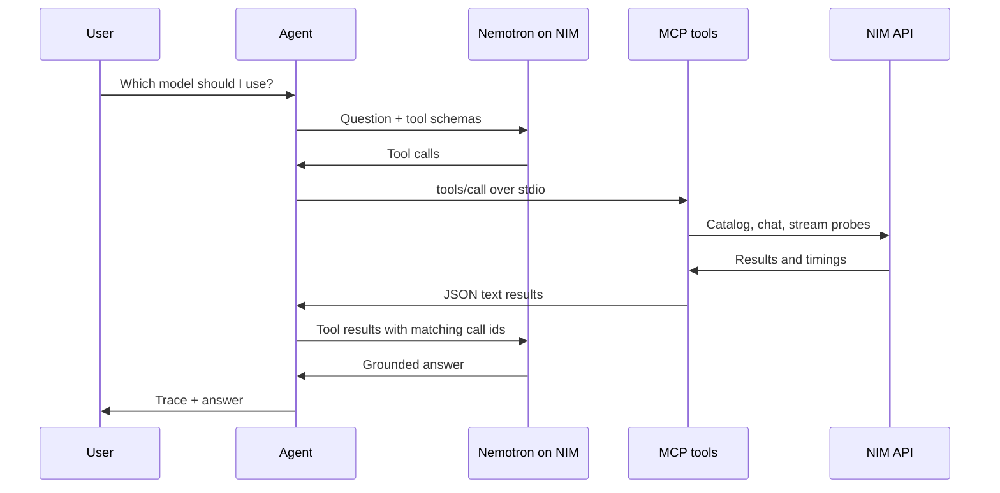

# NIM Concierge

A small developer onboarding agent. Nemotron on an OpenAI-compatible NIM endpoint
chooses tools, calls them over MCP, reads the results, and explains its answer.
The tools use the live catalog and actual API probes, not a model capability database.



## Run

From the repo root, install dependencies with `npm install` and set
`NVIDIA_API_KEY` in your environment using your normal secret manager.

```sh
node agent/agent.mjs
node agent/agent.mjs "Is meta/llama-3.1-8b-instruct still available?"
node agent/agent.mjs "Check my model" --model nvidia/nemotron-3.5-bolt-e4b
node agent/agent.mjs "Compare current small Nemotron models" --json
node --test agent/*.test.mjs
```

`--quiet` prints only the answer. `--max-steps 8` bounds model turns.
`--json` emits answer, steps, tool calls with durations, models used, and route log.
The default router intersects the preferred models with the live catalog, drops
HTTP 410 models and parks retryable failures. `--model` or `NIM_MODEL` pins one
model, which means there is no alternate model for failover.

## Bring your own MCP tools

`--mcp` replaces the built-in server and can be repeated. Commands support quoted
arguments and run directly without shell expansion. Only colliding tool names get
aliases such as `server1__check_model`. MCP text blocks become tool message content.

```sh
node agent/agent.mjs "Use my tools" --mcp "node /path/to/server.mjs"
node agent/agent.mjs --mcp "node agent/mcp-server.mjs" --mcp "node /path/to/other.mjs"
```

The built-in tools are `list_models` (at most 60 ids), `check_model` (tiny chat,
including HTTP 410 detail), `measure_model` (1 to 3 streams, median TTFT and token
rate), and `supports_tools` (a forced dummy function call with validated arguments).
Short measurements compare the sampled models only. Estimated token counts are
marked, failed samples are reported, and no timings are invented.

## Local endpoint

```sh
NIM_BASE_URL=http://localhost:8089/v1 NIM_MODEL=my-model node agent/agent.mjs
# Or use --base http://localhost:8089/v1 --model my-model
```

Local endpoints may omit the key. Tool calling quality depends on the local model
and server, including their support for OpenAI tool schemas and tool result messages.
The same base and key configuration reaches the built-in MCP server.

## Deterministic tool floor

| Condition | Behavior |
|---|---|
| Unknown tool | Return a tool error the model can correct |
| Invalid JSON or missing required field | Return a validation error; do not execute |
| Tool throws | Return its error as tool content |
| Oversized result | Truncate to about 6000 characters |
| Identical consecutive call, third request | Stop with an explicit repetition result |
| Model turn limit | Return an explicit step-limit result |

`runAgent` accepts `chatFn`, `router`, `tools`, `callTool`, and `onEvent` for offline
experiments. `createToolServer` accepts an injected NIM client for MCP transport tests.

Custom `--mcp` commands do not receive NVIDIA_API_KEY unless `--mcp-share-key` is passed. The built-in server receives it.
Exit codes: 0 for a normal answer, 2 for the step limit or repeated-tool stop, and 1 for errors.
