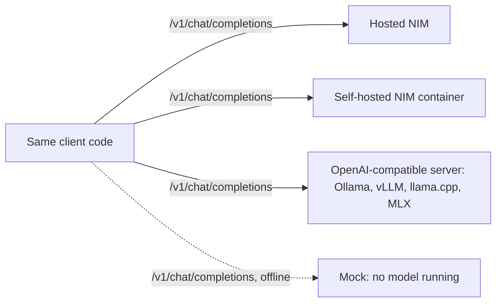

# Hosted to local in one line

The self-hosted NIM container recipe is written from NVIDIA's documentation and has NOT been run by the author. The author's hardware is Apple Silicon, with no NVIDIA GPU. The OpenAI-compatible MLX server path and offline mock have been run.

## 🔌 The idea

Keep the client code and `/v1/chat/completions` request unchanged. Point `NIM_BASE_URL` at another backend and select its model id with `NIM_MODEL`. Query that server's `/v1/models` rather than assuming hosted ids exist locally.

```sh
NIM_BASE_URL=http://127.0.0.1:8089/v1 NIM_MODEL=mock/fast node agent/agent.mjs "Hello"
```

Hosted calls need `NVIDIA_API_KEY`. The mock needs no key; unset the hosted key when working locally. Configure credentials separately if your local server requires authentication.



Default URLs below are alternatives, not servers to start on the same port simultaneously. Check each server's compatibility and selected model's capabilities.

| Backend | `NIM_BASE_URL` | Source for port |
| --- | --- | --- |
| Hosted NIM | `https://integrate.api.nvidia.com/v1` | [NVIDIA API](https://build.nvidia.com/explore/discover) |
| Self-hosted NIM | `http://localhost:8000/v1` | [NIM quickstart](https://docs.nvidia.com/nim/large-language-models/latest/get-started/quickstart.html) |
| Ollama | `http://localhost:11434/v1` | [OpenAI compatibility](https://docs.ollama.com/api/openai-compatibility) |
| vLLM | `http://localhost:8000/v1` | [OpenAI server](https://docs.vllm.ai/en/latest/serving/online_serving/openai_compatible_server/) |
| llama.cpp server | `http://localhost:9931/v1` | [Current server quickstart](https://github.com/ggml-org/llama.cpp/blob/master/tools/server/README.md#quick-start) |
| MLX LM server | `http://localhost:8080/v1` | [Server CLI defaults](https://github.com/ml-explore/mlx-lm/blob/main/mlx_lm/server.py) |
| Offline mock | `http://localhost:8089/v1` | [mock-nim.mjs](./mock-nim.mjs) |

## 🎭 Run the offline mock

From the repository root, with Node >= 20:

```sh
node local/mock-nim.mjs --port 8089 --slow-ms 400 --token-delay-ms 10
```

The banner and every response's `x-mock-nim: 1` header identify the mock. No weights are loaded and no model is running. Text, tool arguments and usage are synthetic. `mock/fast` answers immediately, `mock/slow` delays the first token, `mock/busy` returns 429 with `Retry-After: 2`, `mock/retired` returns an RFC 7807 410, and `mock/flaky` deterministically returns 503 on some requests. Unknown models return 404.

```sh
curl http://localhost:8089/v1/models
curl -N http://localhost:8089/v1/chat/completions -H 'Content-Type: application/json' \
  -d '{"model":"mock/fast","messages":[{"role":"user","content":"Hello"}],"stream":true,"stream_options":{"include_usage":true}}'
# Break the next three requests live:
curl http://localhost:8089/__mock/fail -H 'Content-Type: application/json' \
  -d '{"model":"mock/fast","status":429,"count":3}'
curl http://localhost:8089/__mock/stats
curl -X POST http://localhost:8089/__mock/reset
node --test local
```

Reset clears injected faults, counts and the flaky sequence. It preserves built-in busy/retired behavior. Stats count chat requests by model and HTTP status. For programmable demos, `await startMock({ port: 0, flakyRate: 0.5, seed: 1 })` returns `{ server, base, close }`; await `close()` afterwards. Tools call the first supplied function with `"demo"` for required string arguments, then quote a supplied tool result. This exercises the loop, not model intelligence.

## 📦 Self-hosted NIM container

**Not run by the author: no NVIDIA GPU is available to the author.** This recipe is transcribed from [NVIDIA's current quickstart](https://docs.nvidia.com/nim/large-language-models/latest/get-started/quickstart.html) and [configuration guide](https://docs.nvidia.com/nim/large-language-models/latest/get-started/configuration.html). Check the [prerequisites](https://docs.nvidia.com/nim/large-language-models/latest/get-started/prerequisites.html), GPU/profile support, image license and [NGC catalog](https://catalog.ngc.nvidia.com/orgs/nim/teams/meta/containers/llama-3.1-8b-instruct) before use. A named volume persists `/opt/nim/.cache`; readiness checks `/v1/health/ready` on port 8000. The 16 GB shared memory setting follows [NVIDIA's 1.14 guidance](https://docs.nvidia.com/nim/large-language-models/1.14.0/getting-started.html).

Set `NIM_IMAGE` to your chosen compatible NGC image/tag and load `NGC_API_KEY` into your environment using your credential manager. This recipe requires the key; current NVIDIA docs also describe eligible public images with keyless access. From the repository root:

```sh
# Authenticate without displaying the key. Keep shell tracing disabled.
printf '%s' "$NGC_API_KEY" | docker login nvcr.io --username '$oauthtoken' --password-stdin
docker compose -f local/docker-compose.yml up -d
docker compose -f local/docker-compose.yml ps
curl --fail http://localhost:8000/v1/health/ready
curl http://localhost:8000/v1/models
# Use an id returned above:
export NIM_BASE_URL=http://localhost:8000/v1
# export NIM_MODEL=<returned-model-id>
docker compose -f local/docker-compose.yml down
```

Initial downloads and loading can take time. `down` preserves the cache volume. The healthcheck assumes `curl` exists in your selected image; verify this when deploying an image different from NVIDIA's documented examples.

## ✅ What was actually run

| Path | Status |
| --- | --- |
| Hosted NIM | Run |
| Local OpenAI-compatible server on Apple Silicon via MLX | Run |
| Self-hosted NIM container on an NVIDIA GPU | Not run, no NVIDIA GPU available to the author |

<!-- MEASURED-LOCAL -->

The offline mock is also run in tests and with curl. Its timings and usage are synthetic and are not inference benchmarks.

## What changes when you go local

- Model ids differ. Discover them again and set `NIM_MODEL`.
- Hosted service rate limits give way to your own capacity limits. A local gateway may still enforce rate limits; queues, memory and concurrency remain finite.
- Tool calling quality and support depend on both the model and server.
- Hosted 410 lifecycle retirement gives way to your own upgrades and model availability policy. The mock's 410 is an explicit demo fault.
