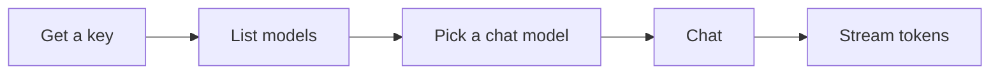

# ⚡ Your first NIM call in 5 minutes

Get a key, export it, then choose curl, Python or Node. Run commands from this repository's root. Each example is self-contained, so you can also copy one file into your own project.



## 🔑 Get a key

Sign in at [build.nvidia.com](https://build.nvidia.com). Open your profile menu, then **Settings > API keys**, and create a key. Keys typically start with `nvapi-`, as described in [NVIDIA's authentication guide](https://docs.nvidia.com/nemo/retriever/latest/extraction/ngc-api-key/). NVIDIA offers [free API access for development](https://docs.nvidia.com/nemo/microservices/25.9.0/generate-synthetic-data/configure-models.html), and the [catalog](https://build.nvidia.com/explore/discover) labels free endpoints.

## Export it

In Bash, this reads the key without echoing it or putting its value in shell history:

```bash
read -rsp 'NVIDIA API key: ' NVIDIA_API_KEY; echo
export NVIDIA_API_KEY
```

## Run curl

Requires Bash, curl and Python 3. The script lists the catalog, picks an available preferred chat model, then prints the answer from an ordinary, non-streamed request. It prints the curl commands with a literal `$NVIDIA_API_KEY` placeholder so you can see the request without exposing your key.

```bash
bash quickstart/curl.sh
```

## 🐍 Run Python

With [uv](https://docs.astral.sh/uv/getting-started/installation/) installed, the inline dependency metadata handles setup:

```bash
uv run quickstart/python/quickstart.py
```

Or use pip in a virtual environment:

```bash
python3 -m venv .venv
source .venv/bin/activate
pip install -r quickstart/python/requirements.txt
python quickstart/python/quickstart.py
```

This uses the official OpenAI Python SDK. Text prints as it arrives, followed by the model id, time to first text token and total request time in milliseconds. Reasoning text is printed when the model sends `reasoning_content` instead of `content`.

Real capture from a hosted run on **2026-11-21**:

```text
Hello!
model=nvidia/nemotron-3.5-bolt-e4b ttft_ms=224 total_ms=247
```

## Run Node

Requires Node 20 or newer. No install step or npm dependencies:

```bash
node quickstart/node/quickstart.mjs
```

This uses built-in `fetch` and parses streamed server-sent events, including events split across network chunks. It prints the same timing summary as Python. Model discovery happens before the chat timer starts.

For the official OpenAI JavaScript SDK variant, copy [quickstart-openai-sdk.mjs](node/quickstart-openai-sdk.mjs) into your project, then run:

```bash
npm install openai
node quickstart-openai-sdk.mjs
```

## It is just the OpenAI API

Your existing Python OpenAI client can use the hosted endpoint by changing its URL and key. [NVIDIA documents the OpenAI-compatible endpoint](https://docs.nvidia.com/nemoclaw/user-guide/openclaw/inference/hosted-inference/use-nvidia-endpoints).

```diff
- client = OpenAI(api_key=os.environ["OPENAI_API_KEY"])
+ client = OpenAI(api_key=os.environ["NVIDIA_API_KEY"],
+                 base_url="https://integrate.api.nvidia.com/v1")
```

In JavaScript, the SDK option is `baseURL`. Each example discovers ids from `GET /v1/models`, then uses the first available preferred chat model. The catalog contains other model types too, so the examples avoid choosing an arbitrary catalog entry. To choose your own chat model, set `NIM_MODEL` to an id returned by your server. An explicit override is sent as supplied, so the server can explain a missing or retired model.

## 🏠 Hosted to local

For a running self-hosted NIM container, or any OpenAI-compatible server exposing model discovery and chat completions, change the environment:

```bash
export NIM_BASE_URL=http://localhost:8000/v1
unset NVIDIA_API_KEY  # When your local server needs no authentication.
# List the server's models and select a chat id:
curl -sS "$NIM_BASE_URL/models"
export NIM_MODEL='your-chat-model-id-from-the-catalog'
node quickstart/node/quickstart.mjs
```

Python and curl use these same variables. If your server requires authentication, set `NVIDIA_API_KEY` to that server's credential. See the [local server guide](../local/README.md) for setup. Each example accepts `NIM_TIMEOUT_SECONDS` (default `120`) for slow servers.

Real capture from an OpenAI-compatible MLX server on Apple Silicon, without a key, on **2026-11-21**:

```text
Hello there!
model=gemma-4-26b-a4b-it-4bit ttft_ms=19846 total_ms=19876
```

This first request included a cold model load on the local server; a warm 5-run benchmark of the same server is in the main README's results section.

## Troubleshooting

| Symptom | What to do |
| --- | --- |
| 401 unauthorized | Check that `NVIDIA_API_KEY` is exported, valid and authorized for the endpoint. |
| 403 forbidden | Check that your key or server credentials are authorized for the model. |
| 404 model not found | Fetch `$NIM_BASE_URL/models` and set `NIM_MODEL` to a current chat model id. |
| 410 end of life | Read the server's `detail`, choose another model from `/v1/models`, and do not retry the retired id. |
| 429 rate limit | Wait before retrying. Reduce request frequency. |
| Empty content from a reasoning model | Check `reasoning_content` or raise `max_tokens`. These examples allow 512 tokens and print reasoning text when content is absent. |
| No preferred chat model in the catalog | Set `NIM_MODEL` to a chat model your server supports. The error lists a few catalog ids. |
| Slow or unreachable server | Check `NIM_BASE_URL` and connectivity, or increase `NIM_TIMEOUT_SECONDS`. |

To check all three languages in sequence with your current environment (requires uv):

```bash
bash scripts/smoke-quickstart.sh
```
